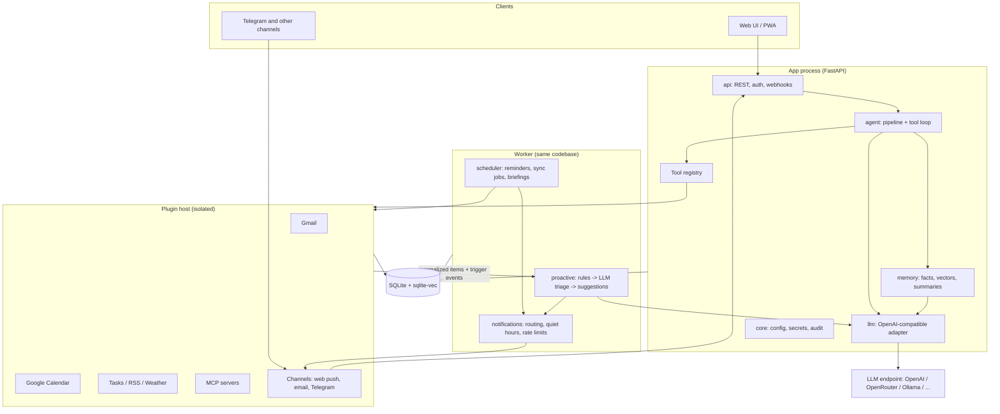
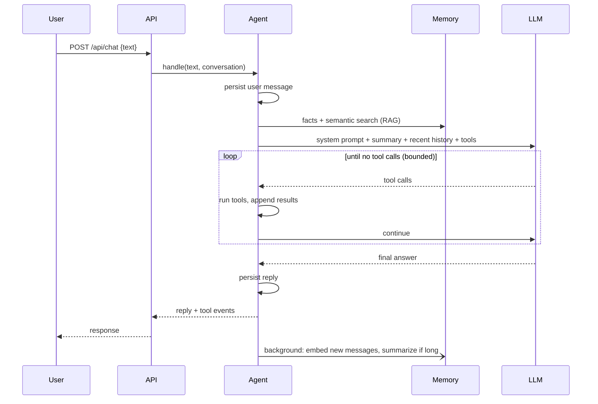
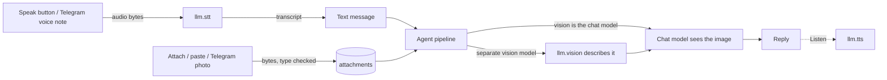
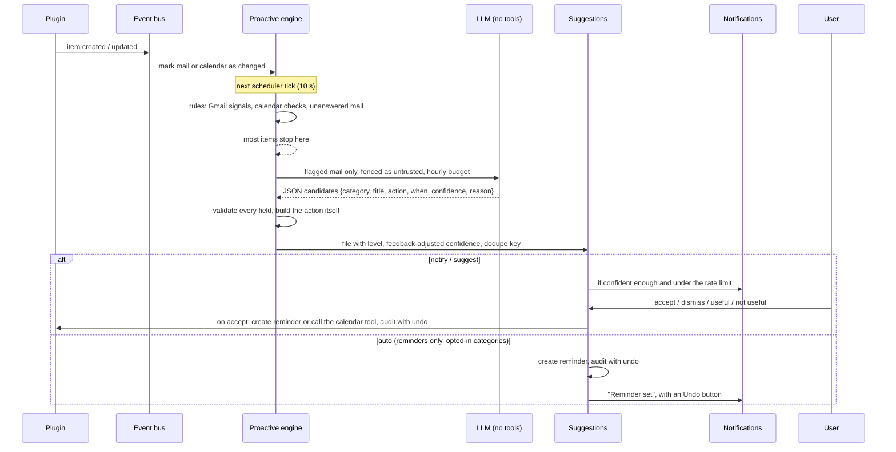
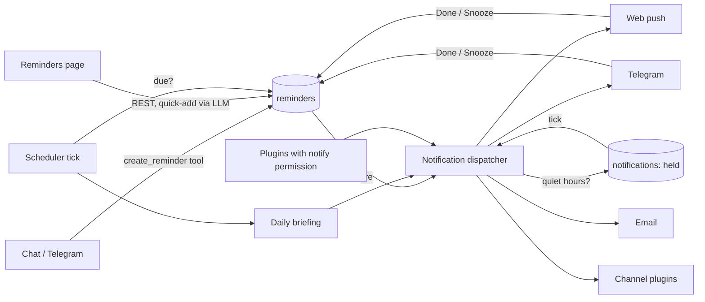
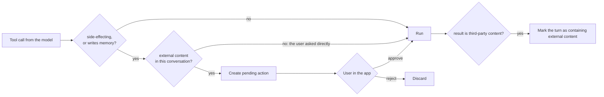

# Architecture

This document describes the whole system as built. Two optional items from the original
design were left out: an MCP bridge for plugins, and running plugins in a subprocess.

## Principles

- **One pipeline.** Text, voice, images and messaging-channel input all become a user turn
  in the same agent pipeline.
- **Everything external is a plugin.** Gmail and Calendar use the same interface as
  third-party plugins. The core knows only the common data model, tools, triggers and
  notification channels.
- **Retrieved content is data, never instructions.** Email bodies, web pages, documents
  and tool results are fenced and labelled untrusted; side-effecting tools triggered while
  such content is in context require confirmation.
- **Approval by default.** Anything that sends, deletes, pays or contacts someone needs the
  user's approval unless they have explicitly opted a category into automatic action.
- **Local first.** Data leaves the server only for the configured LLM endpoint, which may
  itself be local.

## Components



| Module | Responsibility | Status |
|---|---|---|
| `core/` | Layered config, DB engine + models, encryption, settings store, log redaction | built |
| `llm/` | Chat, vision, speech-to-text, text-to-speech, embeddings, retries/backoff, fallback model, JSON tool fallback, connection test | built |
| `media/` | Upload type detection by content, image storage and cleanup | built |
| `memory/` | Facts, embedding store, semantic search | built |
| `agent/` | Pipeline, tool registry, built-in memory tools, summarization | built |
| `api/` | Auth (password, TOTP), HTTP hardening, chat, memory, settings, plugin manager, OAuth callback, webhooks, approvals, reminders, notifications, briefing, suggestions, audit | built |
| `plugins/` | SDK, loader/manager, fault guard, OAuth, item store, Gmail, Calendar, examples | built (no MCP bridge) |
| `core/events.py` | In-process event bus fed by plugins and the item store | built |
| `reminders/` | Reminder storage and state machine, RRULE handling, LLM tools, quick-add parsing | built |
| `notifications/` | Dispatcher (per-category routing, quiet hours, fallback, retries), web push, Telegram, email | built |
| `scheduler/` | Tick loop running reminders, held notifications and the daily briefing | built |
| `proactive/` | Event bus consumer, rule filters, LLM screening of mail, suggestion inbox, levels, feedback, rate limits | built |
| `audit/` | Audit log of tool calls and proactive actions, undo | built |

## LLM adapter (built)

`LLMClient` wraps the `openai` SDK pointed at a configurable `base_url`. Five slots —
`chat`, `vision`, `stt`, `tts`, `embeddings` — each with `base_url`, `api_key`, `model`,
`temperature`, `max_tokens`, `timeout`. Non-chat slots inherit endpoint and key from `chat`
when unset (the key is inherited only for the same `base_url`, so it is never sent to a
different server).

- **Retries**: timeouts, connection errors, 408/409/429 and 5xx are retried up to
  `max_retries` with exponential backoff and jitter, honouring `Retry-After`. SDK retries
  are disabled so that retrying can span models.
- **Fallback**: when the primary model fails (retries exhausted or a non-retryable error),
  the request is replayed on `llm.chat.fallback`. The reply records `used_fallback`.
- **Tool calling**: native `tools` first. In `tool_mode: auto`, a 400/422 on a request with
  tools switches that `(base_url, model)` to JSON-in-prompt: the tool catalogue goes into
  the system prompt, tool history is rewritten as plain messages, and the reply is parsed
  as `{"tool_calls": [...]}` or `{"final": "..."}` (tolerating fences and surrounding prose).
- Optional parameters are sent only when set, since some models reject them.

## Request flows

### Text (built)



Context assembly, in order: system prompt (persona, current time in the user's timezone,
injection rules), known facts, rolling summary, retrieved chunks inside
`<retrieved_context>`, then the last `history_window` messages verbatim.

### Voice and images (built)



Voice and images are inputs to the same pipeline as text; nothing downstream is special.

- **Voice.** Audio is transcribed and discarded; the transcript becomes an ordinary user
  message. In the web UI it lands in the message box first so a mis-hearing can be fixed;
  in Telegram the reply quotes what was heard.
- **Images.** If `llm.vision` resolves to the chat model, images are sent inline with the
  message, and stay in view for follow-up questions (newest first, up to
  `uploads.max_images_per_message`). Otherwise the vision model writes a description once,
  which is stored on the attachment and used in place of the image from then on.
- **Trust.** A turn whose history window contains an image is tainted, exactly like one
  that read an email, so side-effecting tools are held for approval. The vision prompt and
  the system prompt both say text in an image is data.
- **Uploads.** The file type is decided from the bytes (JPEG, PNG, GIF, WebP; webm, ogg,
  m4a, mp3, wav, flac), never from the name or declared type, and files are stored under
  random names. Uploads never attached to a message are removed after a day. A model that
  rejects an image produces a clear error and that image is left out of later turns, so
  the conversation is not stuck.
- **No server-side transcoding or image library.** The browser downsizes photos; audio is
  passed through in the container the browser or Telegram produced.

### Proactive events (built)



**Engine** (`assistant/proactive/engine.py`). It subscribes to the event bus, but only to
set two flags (mail changed, calendar changed); the work runs as a scheduler job, so a burst
of synced items costs one pass. On start both flags are set, which covers anything that
arrived while the server was down.

- *Mail pass.* Messages from the last `lookback_days` that have no `proactive_marks` row
  for their current title+body digest. Sent mail and muted senders are skipped. A package
  signal becomes an information-only suggestion by rule. A bill, deadline, request or
  travel signal sends the message to the model, within `max_llm_calls_per_hour`; when the
  budget is used up or the model is down the pass stops, leaves the rest unmarked and
  resumes later (after 10 minutes for an outage).
- *Sweep*, every 5 minutes or when the calendar changed: conflicts, tight transitions
  between two physical places, early meetings tomorrow (from `evening_at`), meeting briefs
  (attendees and recent mail with them), and requests unanswered for `reply_after_days`.
  All pure rules (`calendar_rules.py`). A pending sweep suggestion that no longer holds
  (the meeting moved, the mail was answered) is marked `expired`.

**Why email cannot make things happen.** The model call has no tools. Its reply is parsed
as JSON and each field is checked: category against a fixed list, action against
`reminder | event | none`, dates parsed and required to be in the future, text collapsed to
one bounded line. The action that a suggestion carries is built by the engine from those
checked values; nothing the model returns is executed. The result still waits for the
user, except reminders in categories the user set to `auto`.

**Levels.** `off`, `notify` (the proposed action is dropped), `suggest`, `auto`. `auto` is
accepted by config validation only for categories whose action is a reminder, applies only
when the proposal is a reminder and confidence is at least `auto_confidence`, and writes an
audit entry with an undo. Calendar events always need approval.

**Feedback.** For each category the last 90 days of outcomes are scored (useful or accepted
+1, not useful −1, an offer dismissed without comment −0.5) into a confidence adjustment
between −0.25 and +0.1. A finding whose adjusted confidence is under `min_confidence` is
not filed. A sender with two "not useful" and nothing positive is muted: their mail no
longer reaches the model. `GET /api/suggestions/learning` shows both.

**Rate limit.** A suggestion is sent as a notification only when its confidence is at
least `notify_confidence` and fewer than `max_notifications_per_hour` /
`max_notifications_per_day` suggestion notifications have gone out. Otherwise it sits in
the inbox. Quiet hours apply as for any notification.

### Audit log (built)

`ToolRegistry.call` is the single place tools run, so it carries the audit hook: every
call writes an `audit_log` row (actor, action, readable summary, clipped arguments, whether
external content was in play, whether it changed anything). A small table maps tools to
their reverse (`create_reminder` → `cancel_reminder`, `remember_fact` → `forget_fact`,
`google_calendar_create_event` → `google_calendar_delete_event`); an undo runs that tool,
is claimed first so it cannot run twice, and is itself logged. Held, approved and rejected
actions, and reminders created from suggestions, are logged too.

## Data model

Built in Phase 1:

| Table | Purpose |
|---|---|
| `conversations` | Thread, channel, rolling `summary` and `summary_upto_id` |
| `messages` | User/assistant turns; `meta` holds model, fallback flag, tool events |
| `memory_facts` | Facts and preferences; `source` is `user` or `agent` |
| `embeddings` | `(kind, ref_id)` → text, model, dim, float32 vector blob |
| `settings` | Key/value: UI config overrides (secrets encrypted), password hash |
| `auth_sessions` | SHA-256 of session tokens with expiry |

**Vectors.** Embeddings are stored as blobs in an ordinary table and ranked with
sqlite-vec's `vec_distance_cosine` (in-process scan if the extension cannot load). A `vec0`
virtual table would be faster at large scale but fixes the dimension at creation, which
breaks when the embeddings model changes; at single-user scale a full scan is fine. Rows
carry the model name and only rows from the current model are searched.

Added in Phase 2: `plugins` (enabled flag, config, encrypted secrets and OAuth tokens,
webhook token, last sync/error), `plugin_kv` (cursors), `pending_actions` (held tool calls)
and `items`, the common data model. Plugins normalize everything they sync into `items`:

| Field | Notes |
|---|---|
| `id`, `plugin`, `external_id` | Unique per `(plugin, external_id)` |
| `type` | `item`, `event`, `task`, `message`, `contact`, `document`, `transaction`, `location` |
| `title`, `body`, `url` | Body is what gets embedded |
| `occurred_at`, `starts_at`, `ends_at`, `due_at` | Type-dependent timestamps (UTC) |
| `participants` | People/addresses involved |
| `labels`, `data` | Source labels; type-specific JSON (amount, tracking number, …) |
| `content_hash` | Lets unchanged items be skipped without re-embedding |

Items matching a privacy exclusion are not stored at all, and adding a rule deletes
matching items already stored.

Added in Phase 3: `reminders`, `notifications` (inbox, held queue and delivery log in one
table) and `push_subscriptions` (browser subscriptions, stored encrypted). Added in Phase 4:
`attachments` (uploaded images: message, type, stored file name, vision description).

Added in Phase 5: `suggestions` (category, title, reason, confidence, proposed action,
status, feedback, unique `dedupe_key`), `proactive_marks` (which version of an item has
been analysed) and `audit_log` (actor, action, summary, detail, undo, undone_at).

## Reminders, scheduler and notifications (built)



**Scheduler.** One asyncio loop ticks every `scheduler.tick_seconds` (10 s) and runs three
jobs: fire due reminders, deliver held notifications, send the briefing. There is no
in-memory job store: each job is a query against the database, so a restart loses nothing
and whatever came due while the server was down runs on the first tick. This replaced the
APScheduler idea from the original plan; with every schedule already a database row, a
second job store would only add a way for the two to disagree.

**Reminder times.** The model converts natural language to an ISO local time (or
`in_minutes`) plus an optional RFC 5545 RRULE through the `create_reminder` tool; the
server validates both and never trusts the model with arithmetic it can do itself. Rules
are expanded with `dateutil` in the user's wall-clock time, so "every day at 09:00" stays
at 09:00 across daylight-saving changes. Rules more frequent than hourly are rejected.

**Reminder states.** `scheduled` → fires → `fired` (waiting for Done or Snooze) → `done`.
Snooze returns it to `scheduled` with a new `next_at`. A repeating reminder moves straight
to its next occurrence when it fires and only reaches `fired` when the series ends;
occurrences missed during downtime collapse into a single notification.

**Dispatch.** Every notification is written to the `notifications` table first, then:

1. Outside urgency `high`, quiet hours hold it until they end.
2. It goes to every channel chosen for its category (or the default list) that is ready.
3. If none of those succeeds, the remaining ready channels are tried one at a time.
4. If nothing succeeds it is retried on later ticks (three attempts), then marked failed.
   It stays visible in the app either way.

**Channels.** Web push is implemented directly on `cryptography` and `httpx` (VAPID
signing, aes128gcm payload encryption), so the push service only relays ciphertext; the
VAPID key and the subscriptions are encrypted at rest. Telegram uses long polling, which
needs no inbound connectivity, and serves exactly one configured chat id. Email goes out
through the Gmail API: the channel asks the Gmail plugin to send (`users.messages.send`
with the opt-in `gmail.send` scope), so no mail password is stored. That method is not a
tool, so the model cannot reach it. Plugins with the `notification_channel` capability join the same registry.

**Daily briefing.** Gathers today's events, due tasks, reminders and flagged mail from
`items`, and has the chat model write it up. That call is made with no tools, so text in
an email subject or event title can at worst change the wording of the briefing. If the
model is unavailable a plain list is sent instead. The text is written under fixed headings
(`HEADINGS` in `scheduler/briefing.py`); the API returns it cut into `sections` so the web
and Android Briefing pages can lay it out, along with the previous 14 days.

**Reminders and the approval gate.** Changing, snoozing, completing or cancelling a
reminder is side-effecting and is held for approval once external content is in the turn.
Creating one is not held, because it can only ever message the user and most requests would
otherwise need a click once mail is synced; such a reminder is stored with source
`external` and labelled in the UI.

## Plugin interface (built)

The author-facing guide is [PLUGINS.md](PLUGINS.md); this section is the summary. A plugin
is a directory containing `plugin.yaml` and a Python module.

```yaml
name: weather
version: 0.1.0
description: Weather forecast from Open-Meteo
entrypoint: plugin:WeatherPlugin
capabilities: [data_source, tools, triggers]
sync_interval: 10800
webhook: false
permissions:              # everything else is denied
  network: [api.open-meteo.com]
  data_write: [item]
secrets: []               # stored encrypted, never returned by the API
config_schema: {...}      # JSON Schema, rendered as a form in the plugin manager
oauth: {...}              # optional: provider, scopes, optional_scopes
```

```python
class Plugin:
    async def setup(self): ...
    async def teardown(self): ...
    async def sync(self): ...                      # data source
    async def handle_webhook(self, headers, body): ...
    async def send(self, notification): ...        # notification channel

    @tool(description, json_schema, side_effecting=False, untrusted=True)
    async def some_tool(self, **arguments): ...    # registered as <plugin>_<method>
```

`PluginContext` (`self.ctx`) is the plugin's route to the host: validated config, declared
secrets, an HTTP client restricted to declared hosts (no redirects, optional OAuth bearer),
`upsert_items` / `delete_items` / `query_items`, `emit` for triggers, a namespaced
key/value store, the webhook URL, and a logger. Undeclared access raises
`PermissionDenied`.

**Lifecycle.** `PluginManager` scans the built-in directory and `plugins.dirs`, validates
manifests, and keeps per-plugin state in the `plugins` table. Statuses: `disabled`,
`running`, `needs_config` (settings or secrets missing/invalid), `needs_auth` (OAuth not
connected, revoked, or lacking a newly required scope), `error`. Enabling imports the
plugin fresh from disk as `pa_plugins.<name>`, registers its tools in the `ToolRegistry`
and starts its sync loop; disabling reverses that. Rescanning picks up added, changed and
removed plugins. None of this needs a restart.

**Isolation (decision).** Plugins run in-process. Every entry point goes through a guard
with a timeout and exception capture; consecutive failures trip a breaker that removes the
plugin's tools and stops its loop until the user re-enables it. This protects the app from
plugin bugs but is not a security sandbox: plugin code could bypass `ctx`. A subprocess
host (JSON-RPC over stdio) would add crash and CPU isolation; the SDK was kept
transport-agnostic (async methods, a single context object, JSON-serializable values) so
that can be added without changing plugins. Network permissions would still be advisory
without OS-level sandboxing.

**OAuth.** Authorization-code flow with PKCE. The callback is authenticated by the
single-use `state` issued to the signed-in user (the session cookie is SameSite=Strict and
is not sent on the provider's redirect). Tokens are stored encrypted per plugin, each with
only the scopes its manifest and settings require; write scopes are opt-in settings.

**Push.** Webhooks arrive at `/api/plugins/<name>/webhook` and are authenticated with a
per-plugin random token (`?token=` for Gmail Pub/Sub, `X-Goog-Channel-Token` for Calendar
channels). Handlers only schedule a sync; polling on `sync_interval` remains as fallback.

**MCP.** Planned: a bridge plugin that connects to configured MCP servers and maps their
tools into the registry (side-effecting unless annotated read-only).

## Approval gate (built)



A turn contains external content when retrieved context includes synced items, an image
is attached, or once any tool flagged `untrusted` has returned. The reply written in such
a turn is marked, and later turns that still have it in their history window inherit the
mark; when marked turns are folded into the rolling summary, the conversation's
`summary_tainted` flag keeps it. From then on side-effecting calls, and writes to long-term
memory (`remember_fact`, `forget_fact`, which later prompts trust), are stored in
`pending_actions` and the model is told the action was not executed. Outside text is passed
through `agent/untrusted.py` before it enters a prompt so it cannot close the fence it sits
in. Approving runs the
stored call exactly once (double submits are refused) and writes the outcome into the
conversation. Holding, approving and rejecting are written to the audit log.

## MCP servers (built)

`mcpclient/manager.py` turns each entry under `mcp.servers` into registry tools. One task per
server holds the connection (stdio subprocess or Streamable HTTP, through the official `mcp`
client) and, once it has listed the tools, registers each as `mcp_<server>_<tool>` with
`untrusted_output=True` and `side_effecting=True`. Unless the config names a tool as
read-only or auto-approved, it also has `confirm=True`: the approval gate then holds it on
every call, not only when the turn is tainted (`Tool.needs_approval`). Approval runs it
through the same `ToolRegistry.call`, so the audit log and pending-action flow are shared with
every other tool. A dropped connection (the call sees `CONNECTION_CLOSED`) ends the task's
session; the supervisor unregisters the tools, waits (2 s doubling up to 5 min) and
reconnects, giving up after five failures until `POST /api/mcp/<name>/reconnect`. Start-up never
waits for servers. `GET /api/mcp` reports status without commands, headers or environment.

## Security

| Concern | Approach | Status |
|---|---|---|
| Secrets at rest | Fernet (`PA_SECRET_KEY`, or generated `data/secret.key`, mode 0600) | built |
| Secrets in logs | Redacting log filter; API returns keys masked | built |
| Web auth | Argon2 password, optional TOTP with recovery codes, hashed server-side sessions, HttpOnly SameSite=Strict cookie, lockout, first-run setup code off loopback | built |
| Browser | Content security policy, no framing, same-origin check on writes | built |
| Prompt injection | Fencing that outside text cannot close; approval gate for side-effecting tools and memory writes, kept closed while that content is in the conversation or its summary; images count as untrusted | built |
| Uploads | Type checked by content, size limits, random stored names, served with `nosniff` behind auth | built |
| Channel access | Telegram serves one configured chat id; others get no reply. Bot token kept out of logs and errors | built |
| Notification content | Web push end-to-end encrypted; Telegram and email are opt-in and see message text | built |
| Audit + undo | Every tool call and proactive action is logged; reversible ones have an undo | built |
| Proactive input | Model screening of mail has no tools; output validated field by field; actions built by the engine; automatic mode limited to reminders | built |
| Redaction | Exclude labels/senders/calendars: never stored, embedded or returned by tools | built |
| Plugin permissions | Manifest-declared hosts, item types and secrets enforced by the context | built (not a sandbox) |
| OAuth | PKCE, single-use state, least-privilege scopes, encrypted tokens | built |
| Webhooks | Per-plugin random token, constant-time comparison | built |

## Deployment

A single process (`python -m assistant`) with SQLite in `data_dir`. `docker-compose.yml`
runs the same thing in one container (`app`, non-root, read-only root filesystem), with
`ollama` as an optional profile. Reminders, held notifications and proactive state live in
the database, so they survive restarts without a separate worker or Redis. See
[SECURITY.md](SECURITY.md) for the threat model and deployment checklist.
